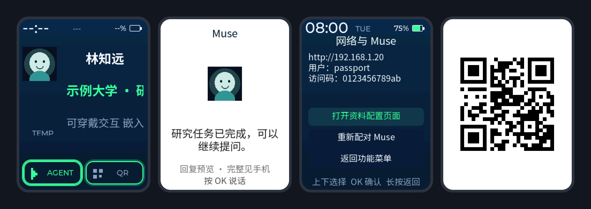

<p align="right"><a href="README.zh_CN.md">简体中文</a> · <strong>English</strong></p>

<h1 align="center">Passport OS</h1>

<p align="center">
  <strong>Open firmware that turns the FoloToy AI Passport into a research identity badge with a Muse AI assistant on board.</strong>
</p>

<p align="center">
  <strong>Identity card first</strong> ·
  <strong>Push-to-talk to your Muse assistant</strong> ·
  <strong>Your own animated character</strong>
</p>

<p align="center">
  <a href="https://github.com/Zhenyu98/passport-os/stargazers"></a>
  <a href="LICENSE"></a>
  
  
</p>

<p align="center">
  
</p>

## What it does

The badge boots straight into your identity card: name, affiliation, research
and an avatar that breathes, blinks and nods. Two buttons lead to the AI agent
and a full-screen QR or business-card image. Everything is driven by the three
buttons on the device.

| Feature | Details |
| --- | --- |
| Identity card | Five profile fields, Chinese and English text, live clock and battery, layout that adapts to the avatar |
| Muse assistant | Bluetooth LE pairing in the Muse app, encrypted control session, streamed 16 kHz voice notes, reply preview on screen, eight local notes |
| Device tools for Muse | Muse can read status, set brightness, save a note and switch pages; nothing else |
| Configuration | Phone hotspot portal (default firmware) or LAN page with a one-time code (Muse firmware), plus a USB JSON protocol |
| Network time | The Muse firmware sets the clock from NTP as soon as Wi-Fi is up |
| Animated avatar | Hatch a character with Codex's `$hatch-pet` and convert it with one command ([skill](skills/passport-pet-avatar/SKILL.md)) |
| Mini game | A side-scrolling runner in the hidden menu |

## Two firmware builds

| | Default firmware | Muse firmware |
| --- | --- | --- |
| Toolchain | ESP-IDF 5.5.3, repository root | ESP-IDF 6.0.1, `muse/` |
| Agent page | Explains that the Muse firmware is required | Muse pairing, voice notes, replies |
| Profile editing | Open hotspot `Badge-XXXX` | LAN page with a one-time access code |

Both keep the profile, images and settings in the same NVS records and Flash
partition, so switching firmware with a segmented flash keeps your data.

## Quick start

1. Download `FoloToy-AI-Passport-full.bin` from the
   [releases](https://github.com/Zhenyu98/passport-os/releases), or build it.
2. Flash the merged image at `0x0` (this resets stored data):

   ```text
   python -m esptool --chip esp32c3 -p <PORT> write-flash 0x0 FoloToy-AI-Passport-full.bin
   ```

3. Hold OK for two seconds on the identity card and choose **Wi-Fi config**. On
   the default firmware the phone joins the `Badge-XXXX` hotspot; on the Muse
   firmware, pair in the Muse app first, then choose **Open profile
   configuration**. Set your profile, avatar and QR image from that page.

Building the Muse firmware, setting the Muse SDK token and pairing are covered
step by step in the [Muse integration guide](docs/assets/passport-muse-integration.md).
Button behaviour and the USB protocol are in the
[user guide](docs/assets/passport-os-v0.1-user-guide.md).

## Agent setup

The repository is set up for AI-assisted development (`AGENTS.md`, `skills/`).
Paste this into Codex, Claude Code or another coding agent:

```text
Read docs/agent-setup.md in https://github.com/Zhenyu98/passport-os and follow it
to set up the toolchain and build Passport OS. Show me the plan before installing
anything, never flash a device without my approval, and report the build checks.
```

See [docs/agent-setup.md](docs/agent-setup.md) for the full checklist.

## Known limits

- Muse replies are text. Reading them aloud needs a text-to-speech endpoint of
  your own ([voice guide](docs/assets/passport-agent-voice.md)); a Windows bridge
  is included for local testing.
- The ESP32-C3 has no PSRAM. The Muse control session fits after the memory
  savings in this release, but a full voice round trip has not yet been verified
  on hardware.
- Long replies, Muse history and account tasks stay in the Muse phone app; the
  badge keeps a bounded preview.

## Acknowledgements

- [FoloToy AI Passport](https://github.com/FoloToy/ai-passport) — hardware, BSP and
  the open firmware template this project builds on (MIT).
- [Muse Gadget SDK](https://github.com/facebookincubator/muse-gadget-sdk) by Meta —
  pairing, Wi-Fi and the encrypted control session (Apache-2.0). It is fetched at a
  pinned commit and patched at build time, not vendored. Use of Muse is subject to
  the [Gadget SDK terms](https://gadgets.muse.ai/sdk-terms).
- [ESP-IDF](https://github.com/espressif/esp-idf), [LVGL](https://lvgl.io) and
  [Noto Sans SC](https://fonts.google.com/noto/specimen/Noto+Sans+SC) (OFL).

## License

MIT, see [LICENSE](LICENSE). Third-party components keep their own licenses.
