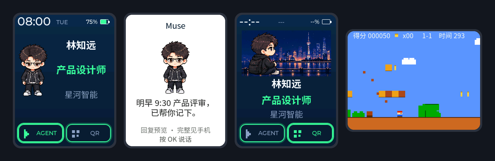
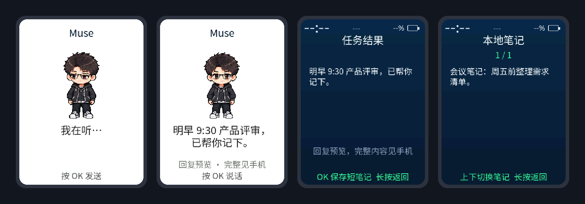
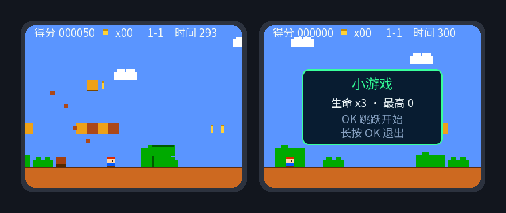

<p align="right"><a href="README.zh_CN.md">简体中文</a> · <strong>English</strong></p>

<h1 align="center">AI PassportOS</h1>

<p align="center">
  <strong>Open firmware that turns the FoloToy AI Passport into a multi-function AI badge.</strong>
</p>

<p align="center">
  <strong>Animated identity card</strong> ·
  <strong>Muse AI assistant</strong> ·
  <strong>Contact QR card</strong> ·
  <strong>Landscape mini game</strong>
</p>

<p align="center">
  <a href="https://github.com/Zhenyu98/ai-passportos/stargazers"></a>
  <a href="LICENSE"></a>
  
  
</p>

<p align="center">
  
</p>

## What it does

One badge, several jobs: it boots into an animated identity card, one button
press opens your Muse AI assistant, and in a quiet moment you can turn it
sideways for a quick game. Everything is driven by the three buttons on the device.

### Animated identity card

Name, role, organization and bio in Chinese or English, with a live clock and
battery level. The avatar is a pixel character that breathes, blinks and nods,
or an animated banner such as the Bund night view; the layout adapts to it. The
QR button opens a full-screen contact card, such as a WeChat QR card: upload a
photo on the phone configuration page, then drag and zoom to frame it.

### Muse AI assistant

The Muse integration is built on Meta's official [Muse Gadget SDK](https://github.com/facebookincubator/muse-gadget-sdk),
pinned to commit [`e6fe517`](https://github.com/facebookincubator/muse-gadget-sdk/tree/e6fe5174092702ffddae6f90759a38d55a4ebae1) and fetched at build time rather than
vendored here.
After Bluetooth LE pairing in the Muse app, the badge becomes a pocket entry to
Muse: press OK to talk, read a reply preview on screen, and keep the full answer
on your phone. Replies can be saved as local notes; the newest eight stay on the badge.
Voice notes go to the badge's own side chat in the Muse app, so your main chat stays
uncluttered. Muse may not carry the main chat's context into it.

<p align="center">
  
</p>

Muse can also operate the badge through a small set of device tools: read
status, set brightness, save a note and switch pages. Nothing else.

### Landscape mini game

The hidden menu holds a side-scrolling platform game. Turn the badge sideways:
UP/DOWN move, OK jumps.

<p align="center">
  
</p>

### Also included

| Feature | Details |
| --- | --- |
| Configuration | Phone hotspot portal (default firmware) or LAN page with a one-time code (Muse firmware), plus a USB JSON protocol |
| Network time | The Muse firmware sets the clock from NTP as soon as Wi-Fi is up |
| Screen sleep | After two idle minutes the screen turns off while the clock and connection keep running; any button lights it again without acting on the page |
| Brightness | Ten levels from 10% to 100%: UP brightens, DOWN dims |
| Custom character | Hatch a character with Codex's `$hatch-pet` and convert it with one command ([skill](skills/passport-pet-avatar/SKILL.md)) |

## Works without Muse

The released firmware includes Muse but does not depend on it. With no token,
no pairing or no network, **Open profile configuration** makes the badge start
its own hotspot, so you can edit your profile, avatar and contact card from a phone.

| | Without Muse | Muse paired and online |
| --- | --- | --- |
| Profile, avatar, contact card | Phone joins the badge's hotspot `Badge-XXXX` | Web page on the same network with a temporary access code |
| Muse AI assistant | Not available | Push to talk, reply previews, local notes |
| Clock | Set from the phone when you save the profile | Synced automatically once online |

The identity card, contact QR card and mini game work either way. Without a
token the badge keeps Bluetooth off, which saves memory and lets the firmware
run in the community's online simulator.

## Quick start

1. Download `FoloToy-AI-Passport-full.bin` from the
   [releases](https://github.com/Zhenyu98/ai-passportos/releases), or build it.
2. Flash the merged image at `0x0` (this resets stored data):

   ```text
   python -m esptool --chip esp32c3 -p <PORT> write-flash 0x0 FoloToy-AI-Passport-full.bin
   ```

3. Hold OK for two seconds on the identity card, choose **Wi-Fi config**, then
   **Open profile configuration**:
   - **Offline**: the screen shows the hotspot name `Badge-XXXX`. Join it on your
     phone (no password) and the setup page pops up; otherwise open `http://192.168.4.1/`.
   - **Online through Muse**: the screen shows an address, the user name
     `passport` and a temporary access code; open the address on the same network.

   Set your profile, avatar and contact card from that page; the badge updates
   right away. The page closes five minutes after it opens.

To use the Muse AI assistant, write your own token and pair in the Muse app as
described in the [Muse integration guide](docs/assets/passport-muse-integration.md).
Button behaviour and the USB protocol are in the
[user guide](docs/assets/passport-os-v0.1-user-guide.md).

## Agent setup

The repository is set up for AI-assisted development (`AGENTS.md`, `skills/`).
Paste this into Codex, Claude Code or another coding agent:

```text
Read docs/agent-setup.md in https://github.com/Zhenyu98/ai-passportos and follow it
to set up the toolchain and build AI PassportOS. Show me the plan before installing
anything, never flash a device without my approval, and report the build checks.
```

See [docs/agent-setup.md](docs/agent-setup.md) for the full checklist.

## Using Muse

- This is an independent open-source project. It is not made, endorsed or
  supported by Meta. Muse is a Meta product and trademark.
- The released firmware **contains no SDK token**. Each user requests their own
  token at [gadgets.muse.ai](https://gadgets.muse.ai/settings/sdk-tokens) and writes
  it to the badge over USB (see the [Muse integration guide](docs/assets/passport-muse-integration.md)).
- Token use is governed by the [Gadget SDK Terms](https://gadgets.muse.ai/sdk-terms): a token is personal,
  so do not share or publish it; one token links to at most 50 devices; devices
  carrying a token must not be sold or listed publicly.

## Known limits

- Muse replies are text. Reading them aloud needs a text-to-speech endpoint of
  your own ([voice guide](docs/assets/passport-agent-voice.md)); a Windows bridge
  is included for local testing.
- The ESP32-C3 has no PSRAM. The Muse control session fits after the memory
  savings in this release, but a full voice round trip has not yet been verified
  on hardware.
- Long replies, Muse history and account tasks stay in the Muse phone app; the
  badge keeps a bounded preview.

## Acknowledgements

- [FoloToy AI Passport](https://github.com/FoloToy/ai-passport) — hardware, BSP and
  the open firmware template this project builds on (MIT).
- [Muse Gadget SDK](https://github.com/facebookincubator/muse-gadget-sdk) by Meta —
  pairing, Wi-Fi and the encrypted control session (Apache-2.0). It is fetched at a
  pinned commit and patched at build time, not vendored. Use of Muse is subject to
  the [Gadget SDK terms](https://gadgets.muse.ai/sdk-terms).
- [ESP-IDF](https://github.com/espressif/esp-idf), [LVGL](https://lvgl.io) and
  [Noto Sans SC](https://fonts.google.com/noto/specimen/Noto+Sans+SC) (OFL).

## License

MIT, see [LICENSE](LICENSE). Third-party components keep their own licenses.
