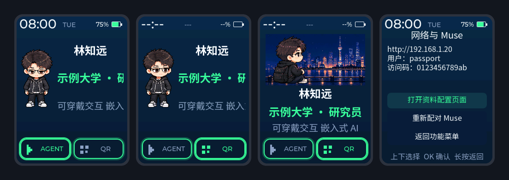

<p align="right"><strong>简体中文</strong> · <a href="README.md">English</a></p>

<h1 align="center">AI PassportOS</h1>

<p align="center">
  <strong>把 FoloToy AI Passport 变成一张科研身份工牌，并内置 Muse AI 助理的开源固件。</strong>
</p>

<p align="center">
  <strong>开机即身份卡</strong> ·
  <strong>按键与 Muse 助理对话</strong> ·
  <strong>换上你自己的动态角色</strong>
</p>

<p align="center">
  <a href="https://github.com/Zhenyu98/ai-passportos/stargazers"></a>
  <a href="LICENSE"></a>
  
  
</p>

<p align="center">
  
</p>

## 它能做什么

工牌开机直接显示你的身份卡：姓名、单位、研究方向，以及会呼吸、眨眼、点头
的头像。底部两个按钮分别进入 AI 智能体页和全屏二维码/名片图。所有操作都用
设备上的三个按键完成。

| 功能 | 说明 |
| --- | --- |
| 身份卡 | 五个资料字段，支持中英文，实时时钟与电量，布局随头像自适应 |
| Muse 助理 | 在 Muse 手机应用中蓝牙配对，加密控制会话，16 kHz 流式语音笔记，屏幕显示回复预览，保留八条本地笔记 |
| 给 Muse 的设备工具 | Muse 只能查状态、调亮度、存笔记和切换页面，不能做其他事 |
| 配置 | 默认固件用手机热点引导页，Muse 固件用带一次性访问码的局域网页面，另有 USB JSON 协议 |
| 网络对时 | Muse 固件连上 Wi-Fi 后自动用 NTP 校准时钟 |
| 动态头像 | 用 Codex 的 `$hatch-pet` 孵化角色，一条命令转换（[技能说明](skills/passport-pet-avatar/SKILL.zh_CN.md)） |
| 小游戏 | 隐藏菜单里的横版跑酷 |

## 两种固件

| | 默认固件 | Muse 固件 |
| --- | --- | --- |
| 工具链 | ESP-IDF 5.5.3，仓库根目录 | ESP-IDF 6.0.1，`muse/` |
| 智能体页 | 提示需要 Muse 固件 | Muse 配对、语音笔记、回复 |
| 资料编辑 | 开放热点 `Badge-XXXX` | 局域网页面加一次性访问码 |

两者把资料、图片和设置存在同一组 NVS 记录和 Flash 分区里，用分段刷写切换
固件时数据会保留。

## 快速开始

1. 从 [Releases](https://github.com/Zhenyu98/ai-passportos/releases) 下载
   `FoloToy-AI-Passport-full.bin`，或自行编译。
2. 从 `0x0` 刷入合并镜像（会重置已保存的数据）：

   ```text
   python -m esptool --chip esp32c3 -p <端口> write-flash 0x0 FoloToy-AI-Passport-full.bin
   ```

3. 在身份卡页长按 OK 两秒，选择「Wi-Fi 配置」。默认固件让手机连接
   `Badge-XXXX` 热点；Muse 固件需先在 Muse 应用中配对，再选「打开资料配置页面」。
   在这个页面里设置资料、头像和二维码图片。

编译 Muse 固件、设置 Muse SDK token 和配对，见 [Muse 接入指南](docs/assets/passport-muse-integration.zh_CN.md)。
按键操作和 USB 协议见 [使用说明](docs/assets/passport-os-v0.1-user-guide.zh_CN.md)。

## AI 助手一键配置

仓库为 AI 辅助开发准备好了 `AGENTS.md` 和 `skills/`。把下面这段发给 Codex、
Claude Code 或其他编程助手：

```text
请阅读 https://github.com/Zhenyu98/ai-passportos 里的 docs/agent-setup.zh_CN.md，
按步骤配置工具链并编译 AI PassportOS。安装任何东西之前先给我看计划，未经我同意
不要刷写设备，最后报告各项编译检查结果。
```

完整清单见 [docs/agent-setup.zh_CN.md](docs/agent-setup.zh_CN.md)。

## 已知限制

- Muse 返回的是文字。要朗读出来，需要你自己提供一个语音合成接口
  （见[语音说明](docs/assets/passport-agent-voice.zh_CN.md)）；仓库附带一个用于本地
  测试的 Windows 桥接。
- ESP32-C3 没有 PSRAM。本版本的内存优化后，Muse 控制会话已经放得下，但完整
  的一轮语音对话还没在真机上验证。
- 长回复、Muse 历史和账号任务保留在 Muse 手机应用里，工牌只保留有限长度的
  预览。

## 致谢

- [FoloToy AI Passport](https://github.com/FoloToy/ai-passport) —— 硬件、BSP 以及
  本项目所基于的开源固件模板（MIT）。
- Meta 的 [Muse Gadget SDK](https://github.com/facebookincubator/muse-gadget-sdk) ——
  配对、Wi-Fi 和加密控制会话（Apache-2.0）。编译时按固定提交获取并打补丁，不随
  仓库分发源码。使用 Muse 须遵守 [Gadget SDK 条款](https://gadgets.muse.ai/sdk-terms)。
- [ESP-IDF](https://github.com/espressif/esp-idf)、[LVGL](https://lvgl.io) 和
  [Noto Sans SC](https://fonts.google.com/noto/specimen/Noto+Sans+SC)（OFL）。

## 许可证

MIT，见 [LICENSE](LICENSE)。第三方组件保留各自的许可证。
